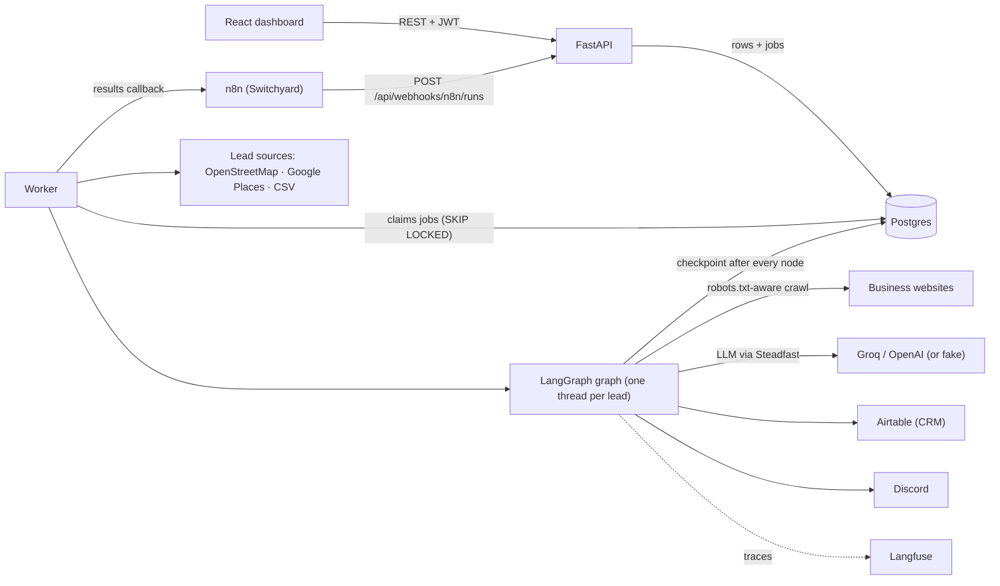
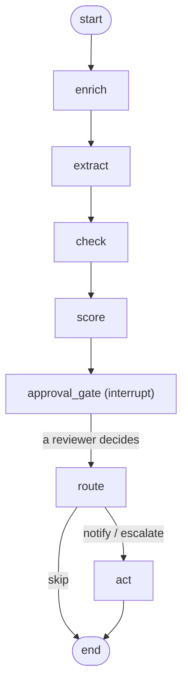
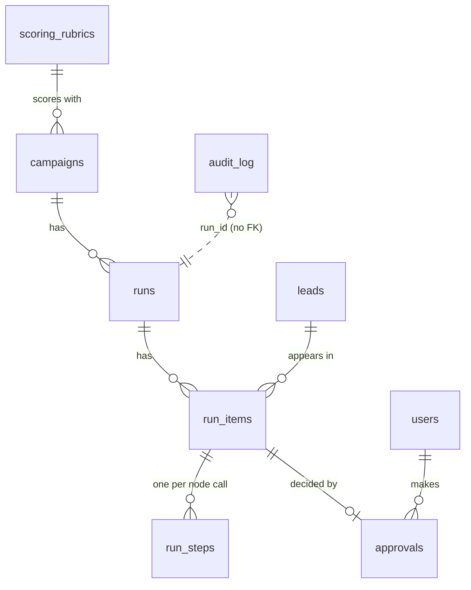
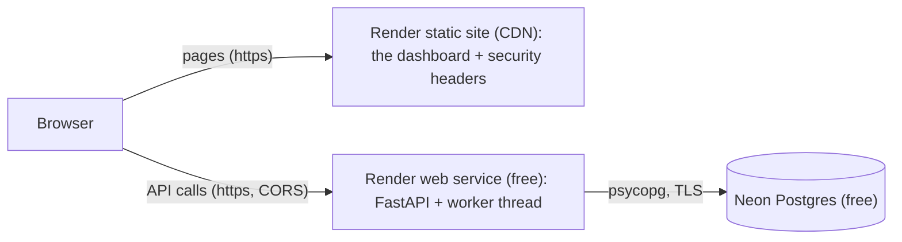

# leadgate — architecture

leadgate turns "niche + city" into scored sales leads. Agents collect businesses, read
their websites, clean and score them, and then **stop**: a person approves or rejects each
lead before anything reaches the CRM. Every step is stored, so a crash loses no work and
the audit log shows who (or which agent) did what.

This page explains how the pieces fit. The SQL work (indexes backed by EXPLAIN ANALYZE,
the reports) has its own page: [sql-notes.md](sql-notes.md).

## 1. The pieces



| Process | What it does | Code |
|---|---|---|
| **api** | Login, the dashboard's REST API, the n8n webhook. Never runs agents: it writes rows and jobs. | `backend/app/main.py`, `app/api/` |
| **worker** | Takes one job at a time from the `jobs` table and runs it. | `app/worker/` |
| **db** | Postgres: the app's tables, the job queue, LangGraph's checkpoints, the append-only audit log. | `app/db/`, `alembic/` |
| **frontend** | The React app: static files on nginx (local) or a CDN (live demo). | `frontend/` |

There is no Redis and no Celery: the job queue is a Postgres table, so a job and the
rows it belongs to are saved in one transaction.

## 2. One lead's journey

A run collects leads, then gives each lead its own LangGraph thread. The graph runs until
the approval gate, waits there (for hours if needed), and finishes when a person decides.



| Node | What it does | Uses the LLM? |
|---|---|---|
| `enrich` | Reads up to 4 pages of the lead's own website (robots.txt respected, 1 s between requests to a site, public addresses only): emails, phones, social links, site signals (https, mobile viewport, copyright year, contact form). Reuses findings younger than 14 days. | no |
| `extract` | Cleans the data by rule first (phones to E.164 with `phonenumbers`), then asks the LLM for the fields that need reading (email, area, city, category, services, founding year). A traceability check sends back any value that isn't in the source data or the website text. | yes |
| `check` | Flags possible duplicates (same phone, domain or source, or a near-identical name nearby), a category that doesn't match the campaign, and closed businesses. | no |
| `score` | Adds up the campaign's rubric (rules stored as data, versioned). The LLM only writes a one-sentence explanation of the points; it never changes the score. | explanation only |
| `approval_gate` | `interrupt()`: the thread stops and is saved. On resume it stores the decision. No side effects, because LangGraph re-runs this node from its top on resume. | no |
| `route` | Rule-based: rejected → skip; approved and clean → notify; approved with serious flags or a failed extraction → escalate. | no |
| `act` | Writes the lead to Airtable (keyed by the thread id, so a retry updates the same record) and posts to Discord; escalations go to the admin channel only. | no |

Every node is wrapped by `@tracked_node` (`app/agents/tracking.py`), the single place that
writes a `run_steps` row (input, output, duration) and an audit row for each node.

## 3. Jobs and the worker

The API never waits for agents. Starting a run writes a `runs` row and a `start_run` job
in one transaction; the worker does the rest.

```mermaid
sequenceDiagram
  participant A as Admin (dashboard)
  participant API
  participant DB as Postgres
  participant W as Worker
  A->>API: POST /api/campaigns/{id}/runs
  API->>DB: run + start_run job (one transaction)
  W->>DB: claim start_run
  W->>W: collect leads from the campaign's sources
  W->>DB: one run_item + one process_item job per lead (one transaction)
  loop each process_item job
    W->>DB: claim it
    W->>W: enrich → extract → check → score → approval_gate
    W->>DB: checkpoint after every node; item = awaiting_approval
  end
```

- **Claiming** is one statement: `UPDATE jobs ... WHERE id = (SELECT id ... FOR UPDATE SKIP
  LOCKED LIMIT 1) RETURNING *`. Two workers never get the same job.
- **Retries:** a job that raises waits 2 s, then 4 s; after 3 attempts the item (or run) is
  `failed` with the error saved.
- **Crash safety:** a job left `running` by a dead worker goes back to the queue (at once
  for the same container, after 5 minutes otherwise). Every handler first asks LangGraph
  where the thread is and only does what's left, so completed nodes never run twice.
  `act` checks `notified_at` and the CRM key, so a message or CRM record happens once.
  This is tested by killing the worker mid-run (`tests/integration/test_worker_postgres.py`)
  and was checked by hand with `docker compose kill worker`.
- **One process when hosting is tight:** `RUN_WORKER_IN_API=true` runs the same loop in a
  background thread of the API (the live demo does this).

## 4. The human decision

A decision is one database transaction, so two reviewers clicking at the same moment
can't both win.

```mermaid
sequenceDiagram
  participant R as Reviewer
  participant API
  participant DB as Postgres
  participant W as Worker
  R->>API: POST /api/run-items/{id}/decision {decision, reason}
  API->>DB: SELECT run_item ... FOR UPDATE
  alt item isn't awaiting approval
    API-->>R: 409 (someone else got here first)
  else
    API->>DB: approval + item status + audit row + resume_item job
    API-->>R: 200
    W->>DB: claim resume_item
    W->>W: approval_gate (stores the decision) → route → act
    W->>DB: item done; run completed when every item is done
  end
```

The unique `approvals.run_item_id` is a second guard under the row lock. When a run that
n8n started completes, a `send_callback` job posts a summary back to n8n.

## 5. Data



- **leads** are unique by `source_key` (`osm:node/123`, `google_places:<id>`,
  `csv:<hash>`). Finding a lead again updates it; it never wipes what reviewers or agents
  stored.
- **run_items** link a lead to a run and carry its LangGraph `thread_id`.
- **audit_log** is append-only: a Postgres trigger refuses UPDATE and DELETE. Its ids
  aren't foreign keys, so the trail never blocks or depends on the rows it describes.
- **LangGraph's checkpoint tables** are created by LangGraph's own `.setup()`, not Alembic.
- The same models run on SQLite (unit tests) and Postgres (everything else); Postgres-only
  parts (the audit trigger, `pg_trgm`, one index) are guarded in the migrations.

## 6. Logs, traces, audit

- Every request gets a correlation id (`X-Request-ID`, or a new UUID). It travels into the
  run, every job payload, the graph state, every JSON log line and every audit row, so one
  id finds a run's whole story.
- With Langfuse keys set, each run item is one trace: a span per node and a generation per
  LLM call (prompt, answer, tokens). Off without keys.
- `GET /api/audit` and the Audit page filter the trail by run, entity, actor, action and time.

## 7. Security basics

- Login: OAuth2 password form → a JWT (60 minutes, HS256), passwords hashed with Argon2.
  Roles `admin` and `reviewer` are checked on every endpoint.
- Changing your password bumps `users.token_version`, which ends every older token.
- Failed logins are audit rows; 5 for one email or 20 from one address within 15 minutes
  → 429. The public demo's reviewer login is exempt from the per-email lock (its password
  is on the login page); the per-address limit still applies.
- The crawler refuses private and internal addresses on every request and redirect hop.
- The dashboard is served with a strict Content-Security-Policy (only its own address; on
  the live demo, also the API's),
  no framing, `nosniff`, and HSTS on the live demo.
- No live outside calls in tests or CI: the LLM runs in fake mode and every outside
  service is faked.

## 8. The live demo



- **Render** (free plan) runs the API from `backend/Dockerfile` with the worker inside
  (`RUN_WORKER_IN_API=true`) and serves the dashboard as a static site. `render.yaml`
  describes both services; `backend/render-start.sh` runs the migrations before the API
  starts.
- The dashboard calls the API on the API's own address (`VITE_API_URL`; the API allows
  that one origin with `CORS_ORIGINS`, and the CSP's `connect-src` allows only it). A
  rewrite through the static site was tried first, but Render's rewrite proxy gives every
  visitor the same address, so one visitor's failed logins would lock everyone out.
- **Visitor addresses:** Cloudflare, then Render's edge (`10.x`), then a local proxy sit
  in front of the API. `FORWARDED_ALLOW_IPS` trusts exactly those (127.0.0.1, 10.0.0.0/8
  and Cloudflare's published ranges), so uvicorn takes the visitor's own address from
  `X-Forwarded-For` and ignores one a visitor makes up (checked live with a fake
  header).
- **Neon** (free plan) is the Postgres. Render's own free Postgres is deleted after 30 days.
- The demo uses `LLM_MODE=fake` and no outside services: no Google Places, Airtable,
  Discord, n8n or Langfuse calls. Leads come from a CSV of made-up practices
  (`backend/demo/austin-dentists.csv`, `.example` websites, 555 phone numbers) whose
  website findings are stored in advance, so nothing is crawled.
- `python -m app.cli demo --history 1000` set it up once: the demo reviewer, the demo
  campaign and a decided fake history for the dashboard. After that, the worker refills
  the approval queue by itself whenever fewer than 6 items wait.
- Free instances sleep after 15 minutes without traffic; the first request after that
  waits about a minute while the API starts.

## 9. Where to look

| Question | File |
|---|---|
| How is a lead scored? | `backend/app/agents/scoring/rubric.py`, `app/db/seed.py` (the two rubrics) |
| What does the LLM see and how is it checked? | `app/agents/nodes/extract.py`, `app/agents/llm.py` (the only Steadfast import) |
| How does the graph pause and resume? | `app/agents/graph.py`, `app/agents/runner.py`, `app/agents/nodes/approval.py` |
| How are jobs claimed and retried? | `app/worker/jobs.py`, `app/worker/handlers.py` |
| The approval transaction | `app/services/approvals.py` |
| The crawler's rules | `app/enrichment/crawler.py` |
| Run it all locally | `docker-compose.yml` (`docker compose up --build`) |
